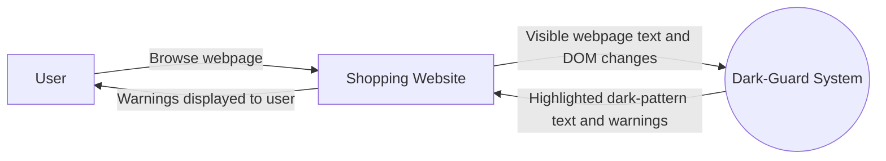
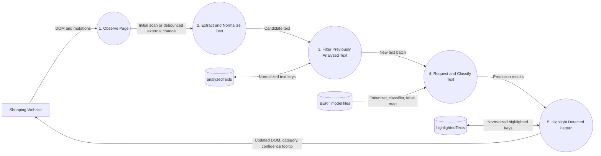
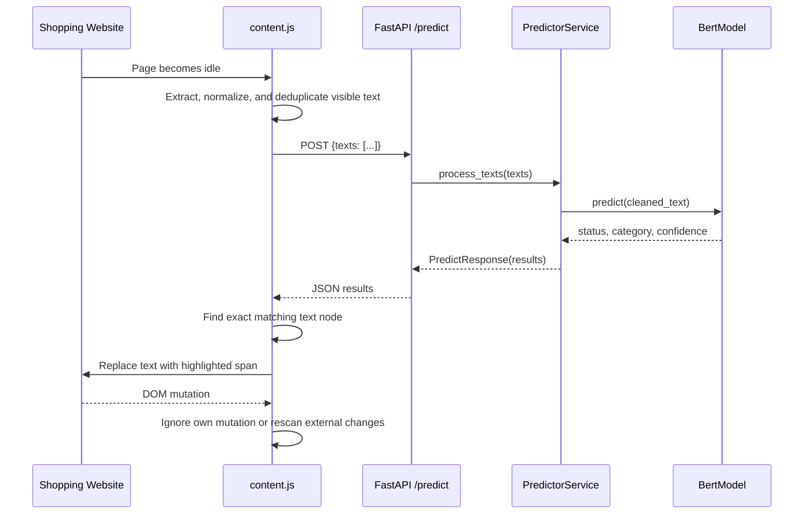

# Dark-Guard System Architecture and Data Flow

This document matches the current `george` branch at commit `7404315`. The implemented runtime scans visible webpage text in a Chrome extension, sends batches to FastAPI, classifies them with the local BERT model, and highlights detected dark patterns. OCR and direct image classification remain planned extensions.

## System Architecture

```mermaid
flowchart LR
    User[User]
    Website[Shopping Website]
    Extension[Chrome Extension<br/>Manifest V3]
    Scanner[content.js<br/>DOM scanner + MutationObserver]
    Styles[styles.css<br/>highlight styles]
    API[FastAPI backend<br/>POST /predict]
    Predictor[PredictorService]
    BERT[BertModel<br/>Tokenizer + classifier]
    ModelFiles[(darkguard-bert-final<br/>config, tokenizer, weights, labels)]

    User --> Website
    Website --> Scanner
    Scanner -->|JSON text batch| API
    API --> Predictor
    Predictor --> BERT
    ModelFiles --> BERT
    BERT --> Predictor
    Predictor --> API
    API -->|results[]| Scanner
    Styles -.-> Scanner
    Scanner -->|Highlighted warnings + tooltips| Website
```

## DFD Level 0: Context Diagram



## DFD Level 1: Main Processes



### Process mapping

| Process | Implementation |
|---|---|
| 1. Observe Page | `runDetector()` and `MutationObserver` in `Extension/content.js` |
| 2. Extract and Normalize Text | `extractTexts()` and `normalizeText()` |
| 3. Filter Previously Analyzed Text | `analyzedTexts` set and duplicate checks |
| 4. Request BERT Prediction | `checkDarkPatterns()` and `POST http://localhost:8000/predict` |
| 5. Highlight Detected Pattern | `highlightDarkPattern()` and `createHighlight()` |

## DFD Level 2: Browser Extension Flow

```mermaid
flowchart TD
    Load([Page loaded]) --> Scan[runDetector()]
    Mutation[DOM mutation] --> OwnChange{Created by<br/>Dark-Guard highlight?}
    OwnChange -->|Yes| Ignore[Ignore mutation]
    OwnChange -->|No| Wait[Debounce for 1 second]
    Wait --> Scan

    Scan --> Select[Select p, span, div, button, a,<br/>headings, and labels]
    Select --> Size{Non-empty and<br/>4 to 500 characters?}
    Size -->|No| Skip[Discard candidate]
    Size -->|Yes| Normalize[Normalize whitespace, case,<br/>and countdown values]
    Normalize --> Duplicate{Duplicate in batch<br/>or already analyzed?}
    Duplicate -->|Yes| Skip
    Duplicate -->|No| Add[Add normalized key<br/>to analyzedTexts]
    Add --> Request[POST /predict with texts[]]
    Request --> Results[Read results[]]
    Results --> IsDark{is_dark_pattern?}
    IsDark -->|No| End([Finish])
    IsDark -->|Yes| Target[Find matching text node]
    Target --> Highlighted{Already highlighted?}
    Highlighted -->|Yes| End
    Highlighted -->|No| Wrap[Create highlight span]
    Wrap --> Tooltip[Attach category and<br/>confidence tooltip]
    Tooltip --> AddHighlight[Add normalized key<br/>to highlightedTexts]
    AddHighlight --> End
```

## DFD Level 2: Backend Prediction Flow

```mermaid
flowchart TD
    Request[POST /predict<br/>{texts: string[]}] --> Validate{texts array<br/>not empty?}
    Validate -->|No| Error422[HTTP 422]
    Validate -->|Yes| Iterate[Iterate over each text]
    Iterate --> Trim[Trim text]
    Trim --> Tokenize[AutoTokenizer<br/>truncation, max length 512]
    Tokenize --> Infer[Sequence classification<br/>with torch.no_grad()]
    Infer --> Softmax[Softmax model logits]
    Softmax --> Select[Select highest probability class]
    Select --> Map[Map class ID using label_map.json]
    Map --> Build[Build PredictionResult<br/>text, status, category, confidence]
    Build --> More{More texts?}
    More -->|Yes| Trim
    More -->|No| Response[PredictResponse<br/>{results: [...]}]
    Infer -. exception .-> Error500[HTTP 500]
```

## Runtime Sequence



## API Data Flow

Request:

```json
{
  "texts": ["Hurry, only 2 items left!"]
}
```

Response:

```json
{
  "results": [
    {
      "text": "Hurry, only 2 items left!",
      "is_dark_pattern": true,
      "category": "Scarcity",
      "confidence": 0.99
    }
  ]
}
```

## Future Visual Detection Boundary

The current repository notes describe two possible future paths:

1. OCR extracts text from an image and sends it through the existing `/predict` endpoint.
2. A future `/predict-image` endpoint sends image pixels to a computer-vision model.

These are not included in the implemented Level 0-2 runtime flow because no image endpoint or OCR service exists in the current checkout.